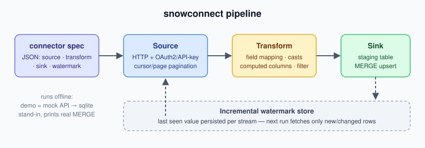

# snowconnect

[](https://github.com/mohdhafizi83/snowconnect/actions/workflows/ci.yml)

Declarative ETL connectors for Snowflake Native Apps. Define a SaaS data-sync
connector as a JSON spec — source (HTTP API + auth + pagination), transform
(field mapping / casts / computed columns), sink (Snowflake staging + `MERGE`
upsert) — and run it incrementally with persistent watermarks.

Built to answer a practical problem: most SaaS APIs (Stripe, HubSpot, Shopify,
Xero…) need the same connector skeleton — authenticate, paginate, map fields,
upsert into Snowflake. This framework makes that skeleton reusable, testable
offline, and deployable as a Snowflake Native App component.

## Architecture



One JSON spec drives the whole run: the source fetches pages (auth +
pagination handled), the transform maps/casts/filters rows, the sink stages
and `MERGE`-upserts, and a per-stream watermark makes every next run
incremental.

## Quickstart (no credentials needed)

```bash
git clone https://github.com/mohdhafizi83/snowconnect.git && cd snowconnect
docker compose up --build   # one-shot offline demo, exits 0 on success
```

Or without Docker:

```bash
pip install -e .
snowconnect demo
```

The demo serves a mock paginated SaaS API on localhost, runs the full
pipeline into a local sqlite stand-in, and prints the Snowflake `MERGE`
statement the sink generates:

```
run 1: fetched=25 written=25   # initial load, 3 pages via cursor pagination
run 2: fetched=0  written=0    # incremental: watermark at last `created`
```

## Connector spec

```json
{
  "name": "stripe_customers",
  "source": {
    "base_url": "https://api.stripe.com/v1",
    "path": "/customers",
    "auth": { "type": "oauth2", "token_url": "...", "client_id": "...", "client_secret": "..." },
    "records_path": "data",
    "pagination": { "type": "cursor", "cursor_param": "starting_after", "cursor_path": "data.-1.id" },
    "watermark_field": "created"
  },
  "transform": {
    "fields": [
      { "name": "ID", "from": "id" },
      { "name": "CREATED_AT", "from": "created", "cast": "iso" },
      { "name": "NAME", "concat": ["first_name", "last_name"], "sep": " " }
    ],
    "filter": { "field": "status", "not_in": ["deleted"] }
  },
  "sink": { "table": "ANALYTICS.CUSTOMERS", "keys": ["ID"], "columns": ["ID", "CREATED_AT", "NAME"] }
}
```

Auth strategies: API key (header/query), bearer, OAuth2 client-credentials
with automatic refresh. Pagination: page-number or cursor. Watermarks persist
per stream so reruns only fetch new records.

## Run

```bash
snowconnect run examples/stripe_customers.json --dry-run   # show generated MERGE SQL
snowconnect run myspec.json --db local.db                  # execute against sqlite stand-in
```

For real Snowflake, pass any DB-API connection (e.g.
`snowflake.connector.connect(...)`) to `Pipeline(spec, sink_connection=conn)`.
`snowflake-connector-python` is intentionally NOT a hard dependency.

## Security

Source URLs come from spec files, so they pass an SSRF guard
(`snowconnect/ssrf.py`): http/https only, no `user:pass@` userinfo, the host
is resolved and **every** address must be public (private, loopback,
link-local incl. `169.254.169.254`, multicast, reserved are rejected);
redirects are refused; responses are capped (default 50 MB) and requests
time out (default 30 s, both spec-configurable).

```bash
# loopback is blocked by default — clean one-line error, no traceback:
echo '{"name":"x","source":{"base_url":"http://127.0.0.1:9"}}' > /tmp/bad.json
snowconnect run /tmp/bad.json
# snowconnect: error: host '127.0.0.1' resolves to blocked address 127.0.0.1 ...

snowconnect --verbose run /tmp/bad.json   # full traceback when you want it
```

`"allow_private": true` in a source spec disables the address checks for
local testing (the demo's localhost mock API uses it) — never for production
specs. Sink identifiers are allowlist-validated (no SQL injection via spec).
Threat model, `allow_private` semantics, and known limitations (DNS
rebinding TOCTOU): [SECURITY.md](SECURITY.md).

## Design notes

- **Testable without cloud**: the whole pipeline runs against sqlite via
  `SqliteAdapter` (MERGE → `INSERT OR REPLACE` dialect switch). CI needs no
  Snowflake account. See `tests/` — 39 tests, mocked HTTP via `responses`.
- **Incremental loads**: watermark state in `.snowconnect/state.json`; a
  connector that fails mid-run resumes from the last committed watermark.
- **Native App path**: the generated `MERGE` SQL and spec format map 1:1 to
  Snowflake Native App shared data / event-table patterns; a connector is one
  Python module + one spec file.
- **Safety**: table/column identifiers are validated (no injection via spec).

## Documentation

- [Getting started](docs/getting-started.md) — Docker demo, local install, real Snowflake setup
- [Configuration](docs/configuration.md) — every connector-spec field
- [Security policy](SECURITY.md) · [Changelog](CHANGELOG.md)

## Status

v0.1 — core framework, offline demo, SSRF-guarded HTTP source, 39 passing
tests. Roadmap: YAML specs
in core, dbt snapshot mode, Native App packaging script, more built-in
connectors (HubSpot, Xero).

MIT © Mohd Hafizi Mohammad Nor
